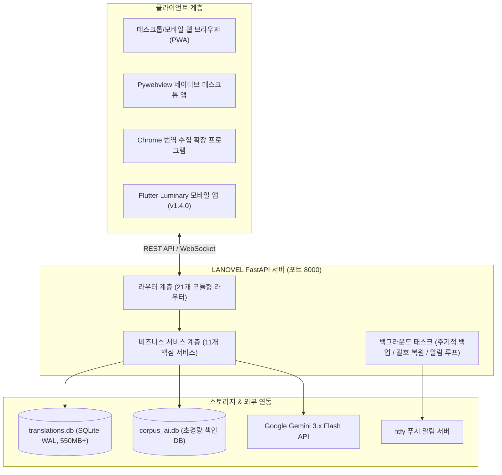

# LANOVEL 서버 기능 명세서 (v3.0 - Production Architecture)

**최종 갱신일**: 2026-10-11  
**문서 버전**: v3.0 (Production Core & Aesthetic UI Specification)  
**기반 기술**: FastAPI, Python 3.11, SQLite (WAL 모드), SQLAlchemy, Jinja2, Pywebview, Flutter (Mobile)

---

## 1. 프로젝트 개요 & 시스템 아키텍처

LANOVEL은 대규모 일본어 웹소설(소설가가 되자, 카쿠요무, 노벨업, 하멜른 등) 번역 관리, 감상, 품질 검수 및 로컬 코퍼스 학습을 아우르는 올인원 번역 플랫폼입니다.

---

## 2. AI 번역 엔진 & 쿼터 가드 시스템

* **다중 모델 분배 번역 (`translation_engine.py`)**:
  - Google Gemini 최신 모델군(`gemini-3.0-flash`, `gemini-3.6-flash`, `gemini-3.7-flash`, `gemini-3.8-flash`)을 문장 길이와 난이도에 따라 분배하여 처리.
  - 지수 백오프(`tenacity`) 재시도 및 오류 복구 로직 내장.
* **RPM Breather & 쿼터 리셋 동기화 (`rpm_manager.py`)**:
  - API 분당 호출 제한(RPM) 초과 방지를 위한 능동적 호흡(Breather) 지연 알고리즘.
  - 일일 쿼터 집계 및 초기화 시점을 Gemini API 리셋 시각(KST 16시/17시)으로 일원화.
* **제외 번역 안전 백업 및 복원 (`test_exclude_restore.py`)**:
  - 광고, 배너, 작가 후기, 사이트 공지 등 번역 불필요 단락의 안전 필터링.
  - 확장 프로그램 및 서버 간 제외 데이터의 상호 백업 및 원클릭 복원(Restore) 지원.
* **ntfy 실시간 진행률 푸시 알림 (`notifications.py`)**:
  - 번역 진행도(25%, 50%, 75%, 100%) 및 회차 완료 시 스마트폰/데스크톱으로 즉각적인 시스템 푸시 발송.

---

## 3. 로컬 코퍼스 AI 엔진 (Corpus AI Engine)

축적된 34만+ 문장 코퍼스를 오프라인 상태에서도 0.05초 내에 검색·활용할 수 있는 로컬 지능형 엔진입니다.

* **물리적 DB 분리 (`server/corpus_ai.db`)**:
  - 메인 데이터 원장(`translations.db`)과 격리된 30~60MB 규모의 초경량 전용 색인 DB 운영.
* **2-Tier EBMT(예제 기반) 번역 합성기**:
  - **Tier 1 (문장 템플릿 치환)**: 유사도 75% 이상 문장의 구조적 뼈대를 유지하고 고유명사/단어 슬롯만 치환.
  - **Tier 2 (N-gram 구문 스티칭)**: 최장 일치 구문 분해 및 공기 확률 조립으로 자연스러운 한국어 초안 생성.
* **어투 일관성 신호등 & 고스트 텍스트**:
  - 소설별 어투(존댓말/반말, 종결어미) 일관성을 실시간 분석하여 신호등으로 피드백.
  - 뷰어 및 에디터에서 타이핑 중 다음 구문을 흐린 글씨(Ghost Text)로 즉시 자동완성 제안.
* **어휘 분해 & 인터랙티브 퀴즈 (`dictionary_service.py`)**:
  - 일본어 문장의 형태소 어휘 분해(Sentence Breakdown).
  - 듀오링고 스타일의 단어 맞추기 / 문장 재배열 인터랙티브 학습 퀴즈 제공.

---

## 4. AI 번역 품질 검수 & 재재번역 (AI Review & Re-translate)

* **4대 악성 번역 결함 정밀 감지**:
  - 다국어 오염(일본어/중국어/외국어 누출), 번역문 밀림(Off-by-One), AI Slop(시스템 멘트/무한루프), 극단적 비문 적발.
* **4분위수(P25, P50, P75) 모델 분배 재재번역 큐**:
  - **하위 25% (단문/감탄사)**: `gemini-3.0-flash`
  - **25~50% (단·중문 일반 서술)**: `gemini-3.6-flash`
  - **50~75% (중·장문 복합 문장)**: `gemini-3.7-flash`
  - **상위 25% (초장문/고난도 묘사)**: `gemini-3.8-flash`
* **Human-in-the-Loop 검수 UI**:
  - 3D 맥락 패널을 통한 전후 문맥 확인.
  - 틴더형 카드 스와이프 / 일괄 승인 / 직접 편집(Editable Input) 인터페이스.

---

## 5. 테마 & UI 디자인 (Aesthetic Experience)

* **서재 (`/library`) - 증기 차분기관 테마 (Steam Difference Engine)**:
  - 3D 기어 회전, 스팀 배관 증기 파티클, 5구 압력계 아날로그 게이지 HUD.
  - 소설별 읽은 회차, 책갈피, 태그, 핀 고정, 빠른 목차 이동.
* **뷰어 (`/viewer`) - 3D 진공관 닉시관 테마 (Nixie Tube)**:
  - 빛나는 오렌지색 닉시관 숫자 카운터 및 레트로 진공관 앰비언트 글로우.
  - 실시간 코퍼스 AI 초안 생성, 단락 단위 빠른 수정, 단축키 탐색 지원.
* **관리자 (`/admin`) - 하단 도크형 유사 번역 추천 & 품질 관리**:
  - 화면을 가리지 않는 하단 슬라이딩 도크(Dock) 패널 및 수평 카드 스크롤.
  - 클릭 한 번으로 네이버 사전, Weblio, Jisho 사전 즉시 팝업 연동.
  - 이상 번역 필터, 미분류 보관함 정리, 괄호 복원 도구.
* **DB 에디터 (`/db_editor`)**:
  - 인명·용어 불일치 린터 교정기, 정규식 일괄 치환기, 대용량 단락 편집기.

---

## 6. 데이터 안전성 & 플랫폼 관리

* **SQLite WAL 모드 & 트랜잭션 안전성**:
  - 읽기/쓰기 락 경합 방지 및 대규모 데이터 쓰기 중에도 무중단 조회 가능.
* **자동 백업 & 복원**:
  - 누적 실행 24시간 초과 시 `backups/` 디렉토리에 타임스탬프 기반 자동 스냅샷 생성.
  - 누락된 따옴표 및 브래킷(`「...」`) 주기적 자동 복원 백그라운드 태스크(1800초 주기).
* **미분류 보관함 (`unclassified.py`)**:
  - 새 소설이나 알 수 없는 URL의 번역본이 기존 폴더를 오염시키지 않도록 임시 보관함에 안전 적재 후 사용자가 직접 목적지 지정.
* **PWA & 오프라인 지원**:
  - 서비스 워커(`service-worker.js`)를 통한 오프라인 읽기 캐시 및 단일 파일 독립 HTML 내보내기 지원.
* **모바일 동기화 & 원격 제어 (`/sync`, `/remote`)**:
  - Flutter 모바일 앱과의 증분 동기화.
  - 스마트폰에서 PC 크롬 확장의 번역 탭을 새로고침/다음화 예약/일시정지하는 원격 제어 허브.
