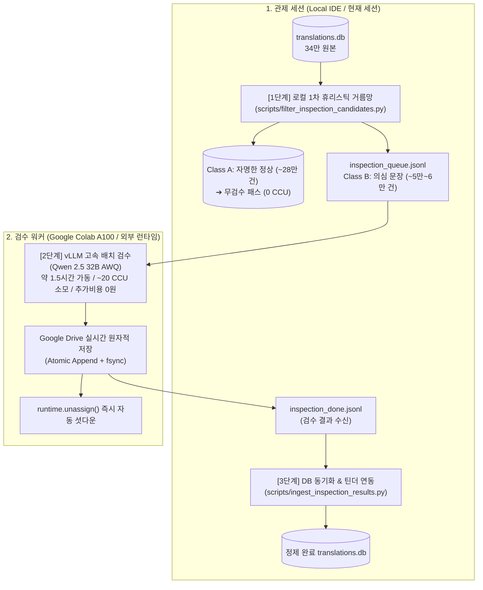

# [검수 특화 기획서] LANOVEL 분리형 코퍼스 검수 파이프라인 명세서

**문서 작성일**: 2026-10-10  
**문서 상태**: 기획 및 설계 완료 (관제-워커 분리형 아키텍처)  
**역할 정의**:
* **본 세션 (Master)**: 프로젝트 관제 및 데이터 오케스트레이션 세션 (로컬 PC)
* **외부 세션 (Worker)**: 무상태(Stateless) 고속 배치 검수 전용 런타임 (Google Colab A100)

---

## 1. 아키텍처 비전 및 세션 역할 분담

단일 세션에서 모든 것을 처리하려다 발생하는 리소스 낭비와 세션 불안정성을 차단하기 위해, **관제(Control)와 연산(Compute)을 완벽히 격리**합니다.



### 1.1 관제 세션 (Master Session - 현재 세션)
* **역할**: 오케스트레이터, 데이터 게이트키퍼, 무결성 검증기.
* **수행 작업**:
  1. 34만 문장 1차 로컬 휴리스틱 스캔 (0원 / 0 CCU).
  2. 검수 워커에 전달할 경량 페이로드(`inspection_queue.jsonl`) 패키징.
  3. 워커가 완료한 결과 수신, 스키마 검증, 트랜잭션 기반 `translations.db` 안전 반영.
  4. 기존 프로젝트의 틴더 카드 검수 UI 연동 관리.

### 1.2 검수 워커 (Worker Session - Colab A100)
* **역할**: 순수 무상태(Stateless) GPU 가속 연산기.
* **수행 작업**:
  1. `inspection_queue.jsonl` 로드.
  2. `Qwen 2.5 32B AWQ` 기반 vLLM 연속 배치 추론.
  3. 실시간으로 Google Drive에 검수 결과 파일(`inspection_done.jsonl`) 원자적 기록.
  4. 연산 완료 즉시 `runtime.unassign()` 호출로 자동 세션 해제 (CCU 낭비 0%).

---

## 2. [Step 1] 로컬 1차 휴리스틱 거름망 (Local Screening) 규격

Colab에 34만 개 전체를 올리지 않고, 로컬 CPU에서 5초 만에 실행되는 **5대 정밀 필터**를 통해 정상 문장을 선별·격리합니다.

### 2.1 5대 휴리스틱 필터 알고리즘
1. **인명/고유명사 불일치 필터 (Name Mismatch)**:
   * 원문(JP)에 소설별 핵심 한자(예: `悠`, `百合華`)가 포함되어 있으나, 번역문(KO)에 지정된 올바른 한글명(`유우`, `유리카`)이 없는 경우.
2. **글자 수 비율 이상치 필터 (Length Ratio Outlier)**:
   * $\text{Ratio} = \text{len(KO)} / \text{len(JP)}$
   * $\text{Ratio} < 0.35$ (극단적 문장 누락/번역 누락 의심) 또는 $\text{Ratio} > 2.5$ (환각, 반복 버그 의심).
3. **특수문자 및 기호 파손 필터 (Symbol Corruption)**:
   * 일본어 따옴표(`「」`, `『』`)의 열림/닫힘 짝이 맞지 않거나, 말줄임표(`……`) 및 물음표/느낌표(`！？`)가 비정상적으로 10회 이상 증식된 문장.
4. **미번역 잔존 필터 (Untranslated Artifacts)**:
   * 한국어 번역문 내에 히라가나(`[\u3040-\u309F]`) 또는 가타카나(`[\u30A0-\u30FF]`)가 2글자 이상 잔존하는 문장.
5. **번역투/위화감 관용구 필터 (Translationese Heuristics)**:
   * `~하는 것이었다`, `~에 있어서`, `고개를 갸웃했다`, `어이어이` 등 대표적인 직역투 키워드 포함 문장.

### 2.2 분류 결과
* **Class A (자명한 정상 문장, 약 28만 건)**: 검수 큐에서 제외, 원본 무결성 보존.
* **Class B (검수 대상 문장, 약 5만 ~ 6만 건)**: `inspection_queue.jsonl`로 패키징.

---

## 3. [Step 2] 검수 워커(Colab A100) 실행 규격

### 3.1 워커 환경 스펙
* **런타임**: Google Colab NVIDIA A100 (80GB VRAM)
* **엔진**: `vLLM`
* **모델**: `Qwen/Qwen2.5-32B-Instruct-AWQ` (가중치 약 18GB, 초당 200토큰 이상의 압도적 처리량)
* **엔진 설정**:
  ```python
  engine_args = {
      "model": "Qwen/Qwen2.5-32B-Instruct-AWQ",
      "quantization": "awq",
      "max_model_len": 2048,
      "gpu_memory_utilization": 0.90,
      "max_num_seqs": 64,
      "enforce_eager": False
  }
  ```

### 3.2 입력 페이로드 (`inspection_queue.jsonl`) 구조
```json
{
  "id": 14205,
  "novel_title": "누나가 마 니 선생이라고 느그 좋아하면 안되나?",
  "source_text": "悠は静かに息を吐いた。",
  "translated_text": "하루는 조용히 한숨을 내쉬었다.",
  "context_prev": "방 안에는 무거운 침묵이 감돌았다.",
  "context_next": "그 시선 끝에 유리카가 서 있었다.",
  "glossary": {"悠": "유우", "百合華": "유리카"}
}
```

### 3.3 출력 결과 (`inspection_done.jsonl`) 구조
```json
{
  "id": 14205,
  "has_error": true,
  "error_type": "인명오독",
  "suggested_fix": "유우는 조용히 한숨을 내쉬었다.",
  "confidence_score": 98,
  "reasoning": "원문의 悠는 남주인공 유우를 가리키며, 번역문의 '하루'는 명백한 오역임."
}
```

### 3.4 리소스 소모 및 예산
* **가동 시간**: 약 1.5 ~ 2시간
* **소모 CCU**: **약 20 CCU** (Google AI Pro 월 200 CCU 중 단 10%만 소모)
* **추가 현금 지출**: **0원 (완전 무료)**

---

## 4. [Step 3] 결과 수신 및 관제 세션 로컬 반영 규격

검수 완료된 `inspection_done.jsonl`이 관제 세션(로컬)으로 복귀하면 다음 절차로 안전하게 동기화합니다.

1. **자동 원본 백업**:
   * 반영 전 `server/backups/translations_backup_before_batch_inspect_YYYYMMDD_HHMMSS.db` 즉각 생성.
2. **3-Tier 신뢰도 분기 처리**:
   * **Tier 1 (Confidence ≥ 95% / 자명한 교정 - 약 80%)**:
     * `translations.db`에 `UPDATE` 쿼리 일괄 트랜잭션 실행 (수초 내 완료).
   * **Tier 2 (Confidence 80 ~ 94% / 애매한 대사 - 약 20%)**:
     * `LANOVEL`의 기존 [틴더 카드 모드] 테이블로 인입하여 사용자가 `Space` 단축키로 쾌속 검토.
   * **Tier 3 (Confidence < 80%)**:
     * 변경 없이 현상 유지 (Pass).

---

## 5. 즉시 착수 액션 아이템

관제 세션(본 세션)에서 가장 먼저 실행할 작업:
1. **[`scripts/filter_inspection_candidates.py`](file:///C:/LANOVEL/scripts/filter_inspection_candidates.py)** 작성 및 실행.
2. 34만 개 문장 대상 5대 필터링 시뮬레이션 및 **실제 의심 문장 건수 통계 리포트 산출**.
3. 생성된 `inspection_queue.jsonl` 파일 확인 후, Colab 워커용 원클릭 실행 노트북(`.ipynb`) 패키징.
