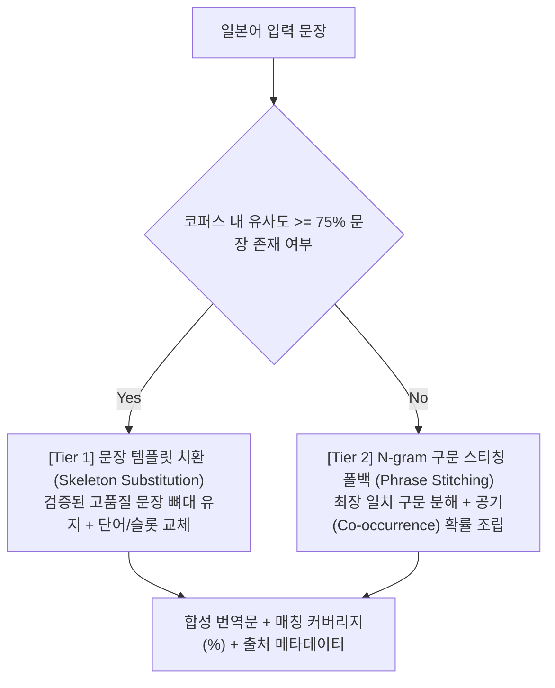
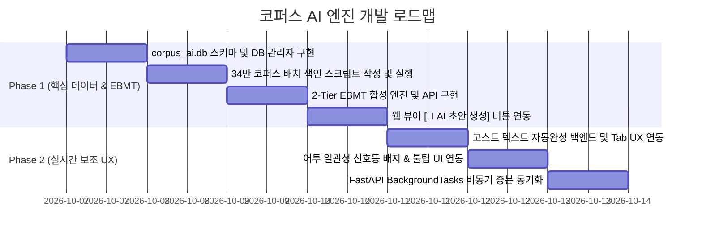

# 34만 코퍼스 기반 로컬 간이 AI 엔진 상세 설계서 (Corpus AI Engine Architecture Spec)

> **문서 상태**: 설계 완료 및 초안 확정 (Architecture Finalized via /grill-me)  
> **기반 데이터**: 34만+ 문장 누적 번역 코퍼스 (`server/translations.db` - SQLite WAL Mode, 556MB)  
> **색인 데이터베이스**: 분리형 전용 색인 DB (`server/corpus_ai.db`, 약 30~60MB)  
> **핵심 철학**: 외부 상용 API(Gemini/OpenAI) 의존도 0%, 순수 룰·통계·N-gram 기반 로컬 초경량 엔진  

---

## 1. 프로젝트 비전 및 목표
수년간 축적된 34만 개 이상의 실제 라이트노벨 원문-번역문 쌍을 증류(Distillation) 및 색인하여, 외부 네트워크 연결 및 API 비용 없이도 0.05초 내에 동작하는 고성능 로컬 번역 합성기 및 지능형 번역 보조 시스템을 구축합니다.

---

## 2. 핵심 아키텍처 결정 사항 (Architecture Decisions)

```mermaid
flowchart TD
    RawDB[("translations.db (556MB)<br/>34만 원본 문장")]
    BatchScript["scripts/build_corpus_index.py<br/>사전 오프라인 인덱서"]
    IndexDB[("corpus_ai.db (30~60MB)<br/>템플릿 / 구문공기 / 어투 통계")]

    RawDB -->|1회 배치 분석| BatchScript
    BatchScript -->|컴팩트 생성| IndexDB

    subgraph RuntimeEngine ["런타임 코퍼스 AI 엔진 (corpus_ai_service.py)"]
        Synthesizer["2-Tier EBMT 합성기"]
        Autocomplete["고스트 텍스트 자동완성"]
        StyleChecker["어투 일관성 신호등"]
    end

    IndexDB -->|0.02초 빠른 룩업| RuntimeEngine
    RuntimeEngine -->|REST API| FrontUI["Web Viewer & Editor UI"]
    FrontUI -.->|신규 번역/교정 저장| BgSync["FastAPI BackgroundTasks"]
    BgSync -.->|비동기 증분(+1)| IndexDB
```

### 2-1. 기반 인프라: 하이브리드 사전 색인 (Pre-indexing) & 분리 DB
* **물리적 DB 분리 (`server/corpus_ai.db`)**:
  - 원본 `translations.db`(556MB)는 사용자 실제 데이터 원장으로 안전하게 격리 보호.
  - 전용 `corpus_ai.db`는 고빈도 구문 정렬표, 대표 문장 뼈대 템플릿, 소설별 어투 확률표만 압축 저장하여 약 **30~60MB**의 컴팩트한 용량 유지.
  - 알고리즘 개선 시 원본 영향 없이 `corpus_ai.db`만 언제든 독립적으로 무중단 재빌드(Atomic Swap) 가능.
* **증분 동기화**:
  - 신규 번역/수정 발생 시 `FastAPI BackgroundTasks`를 통해 UI 지연 없이 백그라운드에서 `corpus_ai.db`에 증분(+1) 반영.

---

## 3. 핵심 모듈별 상세 설계

### 3-1. 2-Tier 폭포수(Cascade) EBMT 번역 합성기
입력된 일본어 문장에 대해 2단계 계층적 매칭을 수행하여 0.05초 이내에 최적의 번역 초안을 생성합니다.



1. **Tier 1 (템플릿 치환 우선)**:
   - 라이트노벨 특유의 빈출 서술/대화문(예: 고개 끄덕임, 검 뽑기 등)에서 75% 이상 일치하는 문장이 있을 경우, 해당 번역문의 문장 구조를 보존한 채 차이 나는 단어만 치환.
2. **Tier 2 (구문 스티칭 폴백)**:
   - 75% 미만인 복합 문장의 경우, 2~5어절 단위 최장 일치 구문(Longest Matching Chunks)으로 분해하고 공기 확률이 가장 높은 한국어 조각들을 이어 붙인 뒤 매칭 커버리지(%)를 산출.

### 3-2. 문맥 인식형 인라인 고스트 텍스트 자동완성기 (Contextual Autocomplete)
* **인터랙션 모델**: VS Code / Copilot 스타일의 **인라인 고스트 텍스트(Inline Ghost Text)**.
* **동작 메커니즘**:
  1. 수동 번역창에서 한글 타이핑 중 멈춤 감지(150~200ms 디바운스).
  2. 현재 타이핑된 접두사(`prefix`)와 현재 문장의 일본어 원문 키워드를 교차 분석.
  3. 현재 소설(`folderName`)의 고유 어휘를 최우선으로 가중하여 다음 올 유력한 표현을 커서 뒤에 **연한 회색 고스트 텍스트**로 미리 렌더링.
  4. 사용자가 `Tab` 키(또는 `Right Arrow`)를 누르면 IME 조합 충돌 없이 즉시 확정 삽입. `ESC` 시 숨김.

### 3-3. 실시간 어투 일관성 신호등 검사기 (Style & Tone Consistency)
* **인터랙션 모델**: 번역창 우측 모서리에 위치한 **신호등(🟢/🟡/🔴) 인디케이터 배지 + 툴팁**.
* **동작 메커니즘**:
  1. 「」 대화문과 일반 서술문을 자동 분리하여 판별.
  2. 원문의 캐릭터 종결어미(`~のだ`, `~じゃ`, `~わ`, `~です`) 대비 입력된 한국어 종결어미의 조건부 확률 $P(\text{ko\_tone} \mid \text{ja\_tone}, \text{novel})$ 계산.
  3. **녹색(🟢)**: 소설 내 기존 어투와 90% 이상 일치.
  4. **황색(🟡)**: 일치율 50~90% 또는 용례 부족.
  5. **적색(🔴)**: 기존 캐릭터 어투와 상반됨(예: 경어 캐릭터인데 반말 종결어미 감지). 툴팁에 추천 종결어미(예: *"추천 어미: ~했단다 (92%)"*) 노출.
  6. 사용자의 타이핑이나 저장을 가로막지 않는 비침습적(Non-blocking) 보조 기능으로 동작.

---

## 4. 데이터베이스 스키마 (`server/corpus_ai.db`)

```sql
-- 1. 고빈도 문장 뼈대 템플릿 테이블 (Tier 1 전용)
CREATE TABLE corpus_templates (
    id INTEGER PRIMARY KEY AUTOINCREMENT,
    ja_skeleton TEXT NOT NULL,          -- 슬롯화된 일본어 문장 뼈대
    ko_skeleton TEXT NOT NULL,          -- 슬롯화된 한국어 번역 뼈대
    frequency INTEGER DEFAULT 1,        -- 코퍼스 출현 빈도
    folder_name TEXT,                   -- 소설 식별자
    original_sample TEXT,
    translated_sample TEXT
);
CREATE INDEX ix_templates_ja_skeleton ON corpus_templates(ja_skeleton);

-- 2. N-gram 구문 정렬 및 공기 확률표 (Tier 2 & 자동완성 전용)
CREATE TABLE corpus_phrase_alignments (
    id INTEGER PRIMARY KEY AUTOINCREMENT,
    ja_phrase TEXT NOT NULL,            -- 2~5단어 일본어 구문
    ko_phrase TEXT NOT NULL,            -- 대응 한국어 번역 조각
    co_occurrence_count INTEGER DEFAULT 1, -- 동시 출현 횟수
    probability REAL DEFAULT 1.0,       -- 조건부 확률 P(ko|ja)
    folder_name TEXT                    -- 특정 소설 가중치용
);
CREATE INDEX ix_phrase_ja ON corpus_phrase_alignments(ja_phrase);
CREATE INDEX ix_phrase_ko_prefix ON corpus_phrase_alignments(ko_phrase);

-- 3. 소설별 캐릭터 어투/종결어미 통계표 (모듈 3 전용)
CREATE TABLE corpus_tone_stats (
    id INTEGER PRIMARY KEY AUTOINCREMENT,
    folder_name TEXT NOT NULL,
    is_dialogue INTEGER DEFAULT 1,      -- 1: 대화문(「」), 0: 서술문
    ja_ending TEXT NOT NULL,            -- 일본어 종결 패턴 (예: じゃ, わ, です)
    ko_ending TEXT NOT NULL,            -- 한국어 종결 패턴 (예: 란다, 어, 습니다)
    count INTEGER DEFAULT 1,
    probability REAL DEFAULT 1.0
);
CREATE INDEX ix_tone_lookup ON corpus_tone_stats(folder_name, is_dialogue, ja_ending);
```

---

## 5. API 엔드포인트 명세

### 1) `POST /api/corpus-ai/synthesize`
* **요청**:
  ```json
  {
    "original": "彼女は静かに頷いた。",
    "folderName": "novel_sample_01"
  }
  ```
* **응답**:
  ```json
  {
    "synthesized_text": "그녀는 조용히 고개를 끄덕였다.",
    "tier_used": "tier1_template",
    "coverage_percent": 95.0,
    "source_example": {
      "original": "彼女は小さく頷いた。",
      "translated": "그녀는 작게 고개를 끄덕였다."
    }
  }
  ```

### 2) `GET /api/corpus-ai/autocomplete`
* **요청 쿼리**: `?original=彼女は静かに頷いた&prefix=그녀는 조용&folderName=novel_sample_01`
* **응답**:
  ```json
  {
    "prefix": "그녀는 조용",
    "suggestion": "히 고개를 끄덕였다",
    "confidence": 0.88
  }
  ```

### 3) `POST /api/corpus-ai/style-check`
* **요청**:
  ```json
  {
    "original": "「そうじゃな、行こうか」",
    "translated": "「그래, 갈까」",
    "folderName": "novel_sample_01"
  }
  ```
* **응답**:
  ```json
  {
    "status": "warning",
    "color": "yellow",
    "score": 0.42,
    "detected_ja_ending": "じゃな",
    "current_ko_ending": "까",
    "recommended_ko_ending": "겠구나",
    "reason": "해당 캐릭터는 주로 노인체/조언체(~겠구나, ~란다)를 85% 확률로 사용합니다."
  }
  ```

---

## 6. 개발 단계별 로드맵 (Phased Roadmap)



### Phase 1: 핵심 데이터 인프라 & EBMT 합성기
1. `server/database_corpus.py`: `corpus_ai.db` SQLite 커넥션 및 모델 매니저 구성.
2. `scripts/build_corpus_index.py`: 34만 원본 문장 전수 분석 및 압축 색인 DB 1회 생성.
3. `server/services/corpus_ai_service.py` -> `synthesize_translation()`: 2-Tier 폭포수 알고리즘 구현.
4. `server/routers/corpus_ai.py` -> `/api/corpus-ai/synthesize`: 엔드포인트 구축.
5. 웹 뷰어 수동 수정 모달에 `[🤖 AI 초안 생성]` 버튼 추가 및 원터치 입력 기능 연결.

### Phase 2: 실시간 보조 UX & 지속적 증분 학습
1. `/api/corpus-ai/autocomplete`: 고스트 텍스트 엔진 및 웹 에디터 Tab 자동완성 이벤트 바인딩.
2. `/api/corpus-ai/style-check`: 어투 분석 엔진 및 에디터 우측 모서리 신호등(🟢/🟡/🔴) 렌더링.
3. 신규 번역/교정 저장 시 `BackgroundTasks`로 `corpus_ai.db` 실시간 증분 학습 연결.
