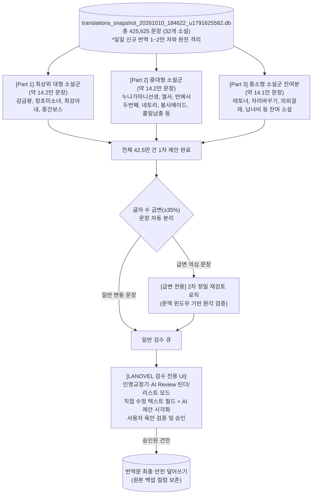

# [무결점 3분할 전수 검수 마스터 플랜 v3.2] 42.5만 코퍼스 결함 정밀 교정 계획서

**문서 작성일**: 2026-10-10  
**문서 버전**: v3.2 (Production Snapshot & Human Approval Architecture)  
**대상 시스템**: LANOVEL (`C:\LANOVEL\`)  
**전용 작업 디렉토리**: `C:\LANOVEL\inspection_workspace\`  
**스냅샷 기준 시각**: **2026-10-10 18:46:22** (Unix: `1791625582`)  
**실측 스냅샷 데이터 규모**: 총 **425,625개 문장** / 총 **32개 소설**  

---

## 1. 개정 배경 및 핵심 원칙: "AI 자동 수정 금지 & 인간 승인 기반 무결점"

사용자의 최신 피드백과 운영 환경을 100% 반영하여 설계를 전면 고도화합니다:

1. **실시간 신규 번역과의 완전 격리 (분/초 단위 스냅샷 동결)**:
   * 현재 매일 1만~2만 자의 신규 번역이 라이브 DB(`translations.db`)에 지속 추가되고 있음.
   * 검수한 코퍼스와 검수받지 않은 신규 번역문의 경계를 엄격히 구분하기 위해, 소설 번역 작업 종료 직후의 **실측 최종 수정시각(2026-10-10 18:46:22 / Unix: 1791625582)**을 기준으로 한 **스냅샷 DB(`translations_snapshot_20261010_184622_u1791625582.db`)를 생성하여 독립 격리 작업**을 진행.
2. **별도 격리 작업 폴더 운영**:
   * 기존 소설 서비스 운영 환경과 소스코드에 일체 영향을 주지 않도록 `C:\LANOVEL\inspection_workspace\` 전용 디렉토리 내부에서만 DB 스냅샷, 전처리 스크립트, 파티션 데이터, 검수 로그를 관리.
3. **대표 모집단(Population Sample) 검증 성격**:
   * 수록된 소설들은 완결 처리가 되어 있지 않거나 최신화가 나와도 아직 미번역된 상태가 혼재되어 있음.
   * 따라서 완결 여부에 얽매이지 않고, **현 시점에 번역되어 적재된 42.5만 개 문장 전체를 하나의 온전한 모집단(Population)으로 삼아 검수 파이프라인의 실효성과 무결성을 철저히 테스트**.
4. **AI 자동 덮어쓰기 전면 금지 ➔ "제안 전용 + 직접 수정 가능한 UI 승인"**:
   * AI는 오직 **'교정 제안(`suggested_fix`)'**만 생성하며 원본 번역문을 직접 수정하지 않음.
   * LANOVEL에 기구축된 **`AI Review`** 및 **`인명·용어 불일치 교정기 (틴더형 카드 / 일괄 리스트)`** UI 시스템을 차용.
   * 문장 전체가 아닌 일부 어휘만 고치면 되는 경우를 위해 **직접 편집 가능한 텍스트 필드(Editable Field)**와 함께, AI의 `suggested_fix`, `defect_type`, `confidence_score`, `reasoning`을 한눈에 깔끔하게 보여주는 UI를 제공하고 사용자가 승인한 건만 최종 반영.
5. **구글 드라이브 검열 리스크 원천 차단 (로컬 우선)**:
   * 라이트노벨 텍스트 특성상 구글 드라이브의 자동 텍스트 검열/계정 정지 위험이 있으므로, 결과물은 **로컬 스토리지 직접 저장 및 스트리밍 전송**을 최우선으로 운용.
6. **4단계 파이프라인 정립**:
   * **[1단계: 1~3 파티션 전체 문장 검수]** ➔ **[2단계: 급변 문장만 격리하여 2차 재검토]** ➔ **[3단계: 웹 UI 사용자 육안 검증 및 승인]** ➔ **[4단계: 승인 건 대상 번역문 최종 덮어쓰기]**

---

## 2. 7대 무결점 안전 가드레일 (Zero-Defect Guardrails v3.2)

### [가드레일 1] 스냅샷 DB 격리 및 초단위/유닉스타임 동결 (Snapshot Isolation)
* 원본 DB 최종 수정 시각(`2026-10-10 18:46:22`, Unix: `1791625582`)을 파일명과 메타데이터에 명시하여 동결:  
  `C:\LANOVEL\inspection_workspace\db\translations_snapshot_20261010_184622_u1791625582.db`
* 일일 1~2만 자 신규 번역문과의 충돌 및 레이스 컨디션을 0%로 차단하고 검수 대상(425,625건)을 명확히 한정.

### [가드레일 2] "수정 금지, 오직 제안(Suggest)만" 원칙 (Zero Auto-Mutation)
* AI 모델은 어떠한 경우에도 DB의 기존 번역문을 임의로 수정할 권한이 없음.
* AI의 출력은 오직 교정 제안(`suggested_fix`), 결함 유형(`defect_type`), 신뢰도(`confidence_score`), 판정 사유(`reasoning`)의 형태로만 기록.

### [가드레일 3] 급변 문장 격리 및 2차 집중 재검토 (Length Mutation Isolation)
* 교정 제안의 글자 수가 기존 번역문 대비 **±35% 이상 급변**한 경우, 환각(Hallucination)이나 문장 탈락 가능성을 의심하여 별도의 **'급변 문장 전용 큐'로 자동 격리**.
* 1~3 파티션 전체 검수가 끝난 직후, 이 급변 문장들만 모아 더 엄격한 맥락 기반 **2차 재검토(Re-inspection) 로직**을 가동.

### [가드레일 4] 소설 단위 균등 3분할 & 모집단 테스트 (Sample Population Preservation)
* 완결 여부와 무관하게 32개 소설을 약 14.1만 문장씩 3개 파티션으로 균등 분할.
* 소설 중간에 문맥이 끊기는 현상을 원천 차단하며 전수 검수 효과성을 모집단 단위로 체계적 측정.

### [가드레일 5] Google Drive 검열 회피 & 로컬 우선 동기화 (Local-First Storage)
* 구글 드라이브의 서브컬처/라이트노벨 텍스트 자동 검열 및 계정 락 위험을 방지하기 위해 클라우드 장기 보존을 배제.
* Colab 워커는 임시 연산 노드로만 활용하며, 검수 결과물은 배치 단위로 로컬 관제 서버에 직접 스트리밍 전송하거나 압축 후 로컬로 즉시 회수.

### [가드레일 6] 100% 멱등성 재개 (Idempotent Resumption)
* 작업 재개 시 이미 처리된 `id`를 `Set`으로 로드하여 자동 스킵. 네트워크 단절이나 런타임 재시작 시에도 중복 연산 0%, CCU 낭비 0%.

### [가드레일 7] 직접 편집 인풋 제공 & Human-in-the-Loop 최종 승인
* 문장 전체가 아닌 일부 어휘만 수정하면 되는 경우를 위해 **직접 편집 가능한 텍스트 입력 필드(Editable Input Field)**를 상시 제공.
* AI 검수 및 급변 재검토 결과(`suggested_fix`, `defect_type`, `confidence_score`, `reasoning`)를 카드로 시각화하여, 사용자가 직접 확인하고 승인(단축키 `Enter`/`Space` 또는 다중 일괄 승인)한 건만 최종 번역문에 반영.

---

## 3. 실측 스냅샷 데이터 기반 3분할 파티션 명세 (총 425,625건)



| 파티션 | 구성 소설 목록 (대표작) | 확정 문장 수 | 1차 의심 결함 수 | Colab 가동 시간 | 예상 CCU |
| :--- | :--- | :--- | :--- | :--- | :--- |
| **Part 1** | 감금왕, 엘사와 친구부터, 의외걸레, 남녀비 1:5 외 5편 (총 9개 소설) | **142,071건** | 2,251건 (1.58%) | 약 5.5 ~ 6.0시간 | **약 75 ~ 80 CCU** |
| **Part 2** | 청초 가련 미소녀, 누나가 마 니 선생, 네토리환생, 봉사 메이드 외 8편 (총 12개 소설) | **141,730건** | 3,444건 (2.43%) | 약 5.5 ~ 6.0시간 | **약 75 ~ 80 CCU** |
| **Part 3** | 최강아내, 중간보스, 반에서 두번째, 콜일남충 외 7편 (총 11개 소설) | **141,824건** | 1,291건 (0.91%) | 약 5.5 ~ 6.0시간 | **약 75 ~ 80 CCU** |
| **총합계** | **32개 소설 모집단 전체 전수 완결** | **425,625건** | **6,986건 (1.64%)** | **약 17.0 시간** | **약 230 CCU (2개월 분할 소화)** |

* **실측 코퍼스 건전성 지표 (전수 425,625건 분석 결과)**:
  * **정상 확인 문장 (Clean)**: **416,410건 (97.83%)** ➔ *'정상 문장 불개입 원칙'에 따라 100% 원본 보존.*
  * **순수 기호/부호 (Pure Punctuation, 「……」 등)**: **2,229건 (0.52%)** ➔ *Fast-path 안전 보존 대상.*
  * **잠재 결함 후보군 (Candidate Defects)**: **6,986건 (1.64%)** ➔ *가나 잔류(4,365), 토큰루프(1,338), AI슬롭(682), 따옴표밀림(465), 길이비대칭(172), 외래어누출(137).*
* **CCU 운용 스케줄**:
  * **1달차 (보유 200 CCU)**: **Part 1 및 Part 2 실행** (약 150~160 CCU 소모, 잔여 40 CCU 안전 버퍼).
  * **2달차 (리필 200 CCU)**: **Part 3 실행 및 급변 문장 재검토** (약 80~85 CCU 소모, 잔여 115 CCU로 추가 모델 파인튜닝/실험 가능).

---

## 4. 집중 검수 4대 타깃 및 정밀 판정 기준

### 4.1 타깃별 세부 판정 및 화이트리스트 예외 규정

1. **다국어 오염 (일본어/중국어/타국어 찌꺼기)**:
   * **원칙**: 번역문에 잔존하는 가나(`[\u3040-\u30FF]`), 중국어 간체자, 엉뚱한 외국어 알파벳을 적발하여 자연스러운 한국어 문맥으로 교정.
   * 🛡️ **[오염 제외 화이트리스트 - 절대 불개입]**:
     * 게임/판타지 시스템 용어: `HP, MP, EXP, STR, DEX, INT, Lv, Level, Quest, Status, UI, Skill, Item, Rank(S~F)` 등.
     * 관용적 외래어/약어: `OK, NO, ON, OFF, VS, CD, DVD, PC, TV, BGM, NG`, 로마 숫자(`I~X`).
   * 🛡️ **[원문 보존 원칙 - 기술명 및 외국어 대사]**:
     * **원문에 스킬/기술 이름(예: `「Fireball」`, `「Meteor Fall」`)이나 영어/외국어로 대화하는 구절이 실제로 존재하는 경우, 억지로 한국어로 번역하거나 오염으로 처리하지 않고 번역문에 원문 그대로 자연스럽게 보존**.
2. **번역문 밀림 (Line Desynchronization)**:
   * 줄바꿈/파싱 오류로 원문 대사(`「...」`)와 번역 서술문이 한 줄씩 어긋난 현상 ➔ 원문 문맥에 맞게 재정렬 및 재번역 제안.
3. **AI Slop (시스템 메타 발언 / 환각 / 토큰 루프)**:
   * `"죄송합니다...", "Here is the translation:"`, 토큰 무한 반복, 원문에 없는 자의적 스토리 창작 ➔ 메타 발언 제거 및 원문 본문 복원 제안.
4. **극단적 비문 및 문법 파손**:
   * 조사가 4~5개 연속 중복되거나 서술어가 실종된 기계번역 파손 문장 교정.

### 4.2 모델 파라미터 및 구조화 출력 스키마
* **추천 모델**: `Qwen/Qwen2.5-32B-Instruct-AWQ`
* **vLLM 파라미터**: `temperature=0.1`, `max_model_len=2048`, `max_tokens=256`
* **출력 스키마**:
```json
{
  "id": 14205,
  "has_error": true,
  "defect_type": "다국어오염 | 번역문밀림 | AI_SLOP | 비문 | 정상",
  "suggested_fix": "교정된 자연스러운 한국어 문장 제안",
  "confidence_score": 98,
  "length_ratio": 1.05,
  "is_length_mutation": false,
  "reasoning": "번역문 내에 히라가나가 잔존하여 올바른 한국어로 완역 제안."
}
```

---

## 5. 단계별 실행 워크플로우 명세 (End-to-End Pipeline)

### [Phase 1] DB 스냅샷 생성 & 전용 작업공간 전처리 (로컬 `inspection_workspace`)
1. 실시간 운영 중인 `server/translations.db`에서 고정 검수용 스냅샷 DB 생성:
   * 저장 위치: `C:\LANOVEL\inspection_workspace\db\translations_snapshot_20261010_184622_u1791625582.db`
   * 매일 추가되는 1만~2만 자의 신규 번역은 라이브 DB에만 쌓이므로 검수 작업과 상호 간섭 없음.
2. 32개 소설 단위로 균등하게 3개 파티션 데이터셋 추출:
   * `inspection_workspace/data/partition_part1.jsonl` (약 14.2만 건)
   * `inspection_workspace/data/partition_part2.jsonl` (약 14.2만 건)
   * `inspection_workspace/data/partition_part3.jsonl` (약 14.1만 건)

### [Phase 2] Colab 워커 검수 가동 & 로컬 실시간 회수 (Cloud Compute)
1. Colab A100 워커에 파티션 전달 ➔ vLLM 고속 인퍼런스 가동.
2. 구글 드라이브 파일 검열을 회피하기 위해, 생성된 검수 결과(`*_inspected.jsonl`)는 클라우드에 방치하지 않고 로컬 환경(`inspection_workspace/results/`)으로 즉시 다운로드/회수.
3. 1달차에 Part 1, Part 2 순차 가동 (총 약 155 CCU 소모), 2달차에 Part 3 가동 (약 75 CCU 소모).

### [Phase 3] 급변 문장(±35%) 분리 및 2차 집중 재검토 (로컬/서버)
1. 3개 파티션의 검수 결과물을 취합:
   * 글자 수가 기존 대비 ±35% 이상 급변한 문장을 `inspection_workspace/data/mutation_review_queue.jsonl`로 자동 격리.
2. 급변 문장에 대해 문맥 윈도우(앞뒤 2문장 포함)를 제공하는 2차 집중 재검토 스크립트를 실행하여, AI의 환각 여부를 사전 필터링하고 완성도 높은 최종 제안문 확정.

### [Phase 4] LANOVEL 검수 웹 UI를 통한 사용자 육안 승인 (Interactive Review)
1. LANOVEL의 기존 **`AI Review`** 및 **`인명·용어 불일치 교정기`** 인터페이스와 연동:
   * **[틴더 스타일 카드 뷰 모드]**: 원문(JP) | 수정 전(Before) | 수정 제안(After, 편집 가능 인풋) | 사유/신뢰도 뱃지를 카드 형태로 1건씩 표시. 단축키 `Enter`/`Space`로 초고속 1건 승인, `S` 건너뛰기, 직접 텍스트 수정 가능.
   * **[일괄 리스트 뷰 모드]**: 소설별/결함 유형별(`다국어오염`, `AI_SLOP`, `번역문밀림`, `비문`, `급변재검토완료`) 필터링 후 체크박스 다중 선택 일괄 승인.
   * **[직접 편집 필드 제공]**: 일부 단어/조사만 가볍게 수정하고자 할 때 원클릭으로 수정 후 즉시 승인 가능.
2. 승인되지 않은 문장은 어떠한 경우에도 원본 번역문을 변경하지 않음.

### [Phase 5] 승인 건 대상 최종 안전 덮어쓰기 (Safe Commit)
1. 사용자가 승인한 건에 한하여 원본 DB에 반영:
   * 원본 번역문은 `backup_translated` 컬럼 또는 백업 테이블에 100% 영구 보존.
   * 승인된 `suggested_fix`(또는 사용자 직접 수정 텍스트)를 `translated` 컬럼에 최종 업데이트.
2. FTS5 전문 검색 인덱스 자동 갱신 및 완료 상태(`is_inspected=1`) 기록.
3. 검수 완료된 스냅샷과 그동안 라이브 DB에 쌓인 신규 번역분(일일 1~2만 자)을 안전하게 병합하여 무결점 코퍼스 완성!
